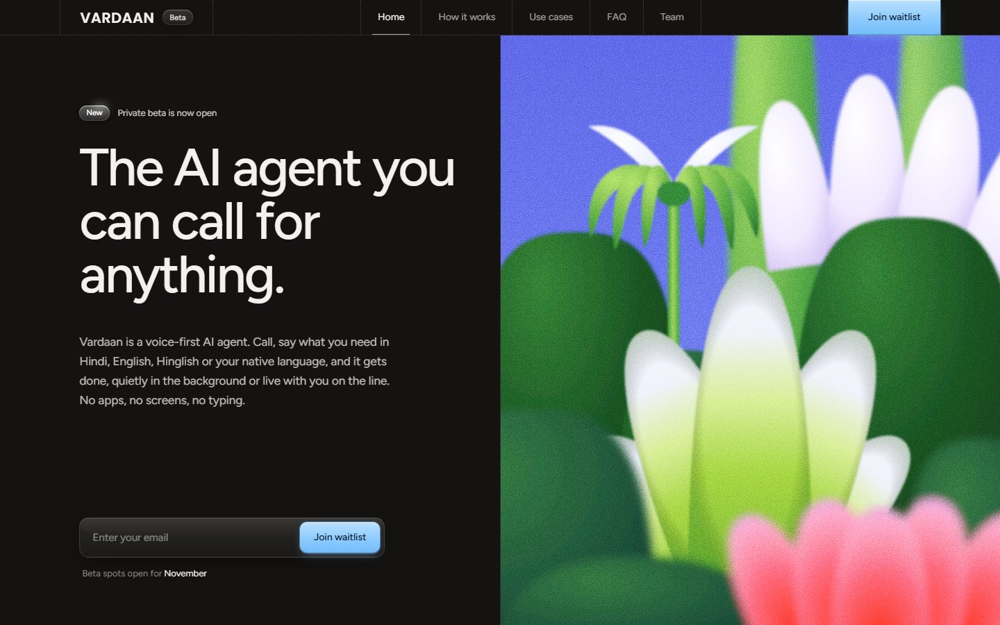
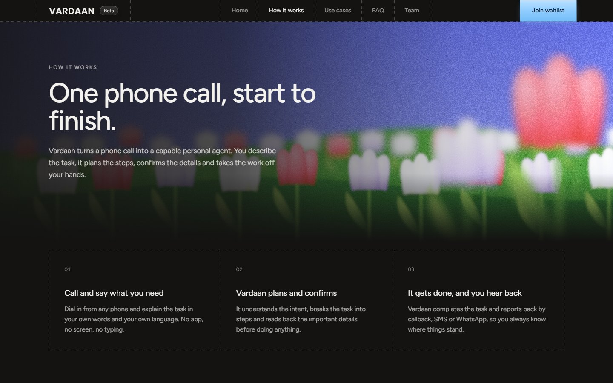
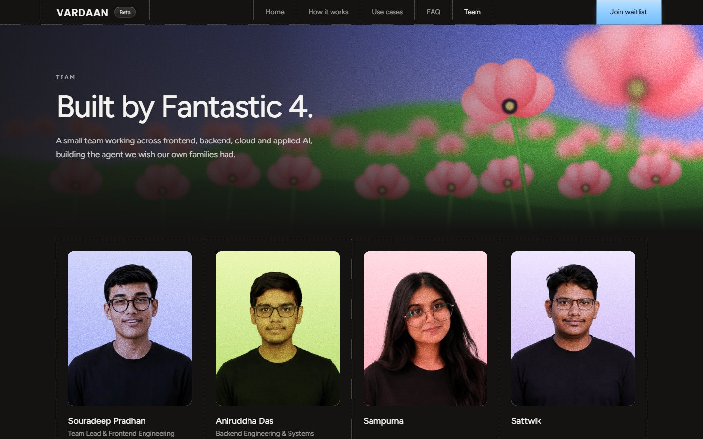

# Vardaan

**The AI agent you can call for anything.**

Vardaan is a voice-first AI agent. You call it, say what you need in Hindi, English or Hinglish, and it gets done, quietly in the background or live with you on the line. No apps, no screens, no typing.

This repository contains the Vardaan website: the beta landing page, the waitlist and the product pages.



---

## Contents

- [The product](#the-product)
- [The website](#the-website)
- [Tech stack](#tech-stack)
- [Getting started](#getting-started)
- [Configuration](#configuration)
- [Project structure](#project-structure)
- [Design system](#design-system)
- [Waitlist](#waitlist)
- [SEO and sharing](#seo-and-sharing)
- [Deployment](#deployment)
- [Team](#team)
- [License](#license)

---

## The product

Getting things done today means switching between apps, navigating confusing websites and waiting on hold. Vardaan turns a phone call into a capable personal agent: you describe the task, it plans the steps, confirms the details and takes the work off your hands.

It works in two modes:

| Mode | What happens |
|---|---|
| **Call & Cut** | Hang up and Vardaan finishes the task in the background (filling a form, sending a professional email, contacting a business, tracking a request or making a booking), then reports back by callback, SMS or WhatsApp. |
| **Talk & Help** | Stay on the line for real-time support: think through a decision, understand a document or bill, get step-by-step guidance, or draft a reply together. |

Vardaan remembers preferences and context, and when information is missing or a decision carries real consequences, it calls back for approval instead of guessing.

---

## The website

| Route | Page |
|---|---|
| `/` | Beta landing page: headline, waitlist form and the botanical poster, fitted to one screen |
| `/how-it-works` | The three steps of a call and the two modes |
| `/use-cases` | Tasks you can hand off and who Vardaan is built for |
| `/faq` | Common questions about the product and the beta |
| `/team` | The Fantastic 4 team |
| `/api/waitlist` | `POST` endpoint that stores waitlist emails |



Highlights:

- **Split-screen landing** in the style of a technical spec sheet: dotted-grid navbar, letter on the left, full-height poster on the right.
- **Original illustrations**, all drawn in SVG with soft focus and film grain: the home poster and a different garden scene for each section page (tulips, lotus pond, daisies, poppies).
- **Hidden footer** that slides up when you scroll or swipe past the end of the page.
- **Small details**: a glowing "New" tag, a glassy waitlist form, and a "Beta spots open for …" line that always names next month.
- **Accessible and responsive**: works from 375px phones to wide desktops, respects `prefers-reduced-motion`, and keeps keyboard focus visible.

---

## Tech stack

| Area | Choice |
|---|---|
| Framework | [Next.js 15](https://nextjs.org) (App Router, static rendering) |
| UI | React 19, TypeScript |
| Styling | [Tailwind CSS 4](https://tailwindcss.com) with design tokens in `app/globals.css` |
| Fonts | Figtree and Poppins via `next/font`; Inter for generated social images |
| Images | `next/image` for photos, inline SVG for illustrations, `next/og` for social cards |
| Hosting | [Vercel](https://vercel.com) |

---

## Getting started

Requirements: **Node.js 18.18 or newer** (20 recommended) and npm.

```bash
git clone https://github.com/fantastic4-team/Vardaan.git
cd Vardaan
npm install
npm run dev
```

Open [http://localhost:3000](http://localhost:3000).

| Script | What it does |
|---|---|
| `npm run dev` | Development server with hot reload (writes to `.next-dev`) |
| `npm run build` | Production build (writes to `.next`) |
| `npm run start` | Serves the production build |

The dev server and production build use separate output folders, so you can run `npm run build` while `npm run dev` is running.

---

## Configuration

Copy `.env.example` to `.env.local` and set:

| Variable | Purpose |
|---|---|
| `NEXT_PUBLIC_SITE_URL` | The production domain, e.g. `https://vardaan.ai`. Used for canonical URLs, the sitemap and Open Graph tags. On Vercel it falls back to the project's production URL. |

---

## Project structure

```text
app/
  page.tsx               Landing page
  how-it-works/          Section pages
  use-cases/
  faq/
  team/
  api/waitlist/route.ts  Waitlist endpoint
  layout.tsx             Fonts, metadata, viewport
  globals.css            Design tokens and component styles
  sitemap.ts, robots.ts, manifest.ts, opengraph-image.tsx, twitter-image.tsx, apple-icon.tsx
components/
  SiteNav.tsx            Dotted-grid navbar with section links
  SectionPage.tsx        Shared layout for the section pages
  PosterArt.tsx          The home page botanical poster (SVG)
  GardenScene.tsx        Header scenes for the section pages (SVG)
  WaitlistForm.tsx       Email form with loading and error states
  RevealFooter.tsx       Footer revealed by scrolling past the end
  NextMonth.tsx          Renders the name of next month
lib/
  site.ts                Site name, title, description and URL
  og-image.tsx           Shared renderer for social preview images
public/images/
  team/                  Team photos
docs/                    Screenshots used in this README
```

---

## Design system

All colours and fonts are defined as tokens in `app/globals.css`:

| Token | Value | Use |
|---|---|---|
| `--color-page` | `#141312` | Page background |
| `--color-ink` | `#f4f2ee` | Primary text |
| `--color-mute` | `#8f8b85` | Secondary text |
| `--color-accent` | `#8ccbff` | Buttons and highlights |
| `--font-sans` | Figtree | Body and headings |
| `--font-poster` | Poppins | The VARDAAN wordmark and poster type |

The illustrations share one palette: periwinkle sky, lime and forest greens, lavender, white and coral, with depth-based blur and a stipple grain overlay (`.poster-grain`).

---

## Waitlist

The form posts to `/api/waitlist`, which validates the email, ignores duplicates and returns clear errors.

> **Before launch:** signups are currently written to `data/waitlist.json`. That works locally, but Vercel's file system is read-only, so in production the endpoint must be connected to real storage, such as Vercel KV / Upstash Redis, Postgres, or an email provider like Resend or Loops. Only `app/api/waitlist/route.ts` needs to change.

---

## SEO and sharing

- Page titles, descriptions and canonical URLs for every route
- Generated Open Graph and Twitter images (`/opengraph-image`, `/twitter-image`)
- `sitemap.xml`, `robots.txt`, web app manifest, favicon and Apple touch icon
- JSON-LD structured data for the organisation and website

---

## Deployment

The site deploys to Vercel automatically on every push to `main`. `vercel.json` pins the framework preset to Next.js and uses `npm ci` for reproducible installs.

To deploy your own copy:

1. Import the repository in Vercel.
2. Set `NEXT_PUBLIC_SITE_URL` under **Settings → Environment Variables**.
3. Connect waitlist storage (see [Waitlist](#waitlist)).

---

## Team

Built by **Fantastic 4**.



| Name | Role | Links |
|---|---|---|
| Souradeep Pradhan | Frontend Developer | [GitHub](https://github.com/pradhan-not-found) |
| Aniruddha Das | Backend & Full Stack Engineer | |
| Sampurna | AI/ML Engineer | |
| Sattwik | Database Manager | |

Each member's website, GitHub and LinkedIn are set in `app/team/page.tsx`; empty links are placeholders (`#`) until filled in.

Questions or feedback: [fantastic4.team.dev@gmail.com](mailto:fantastic4.team.dev@gmail.com)

---

## License

See [LICENSE](LICENSE).
