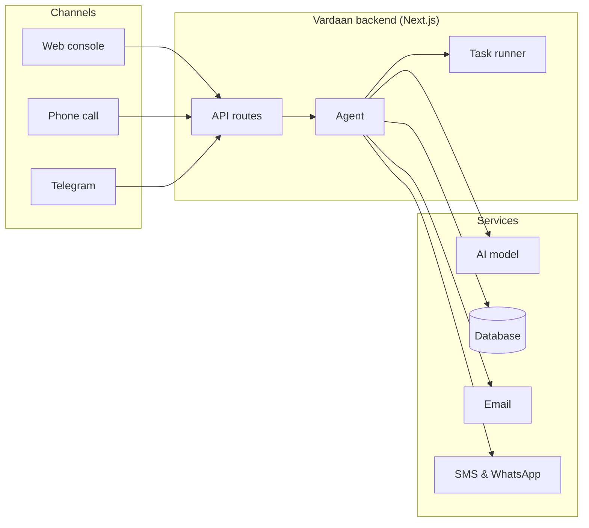
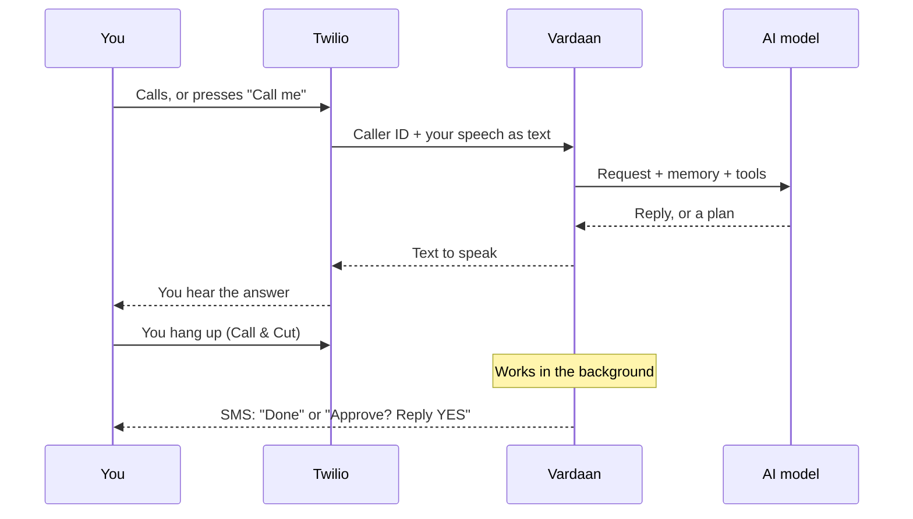
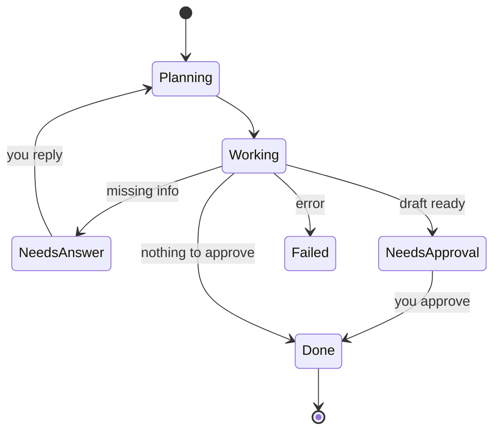

# How Vardaan works

> Everything about the product and the system behind it: the idea, architecture, call flow, the agent, setup, configuration, API and roadmap. Written for the team, testers and anyone curious.

## Contents

1. [Overview](#01-overview)
2. [Two modes](#02-two-modes)
3. [Architecture](#03-architecture)
4. [Call flow](#04-call-flow)
5. [Task lifecycle](#05-task-lifecycle)
6. [The agent](#06-the-agent)
7. [Capabilities](#07-capabilities)
8. [Free vs paid](#08-free-vs-paid)
9. [Limitations](#09-limitations)
10. [Getting started](#10-getting-started)
11. [Configuration](#11-configuration)
12. [API reference](#12-api-reference)
13. [Data model](#13-data-model)
14. [Security & privacy](#14-security--privacy)
15. [Tech stack](#15-tech-stack)
16. [Roadmap](#16-roadmap)
17. [Principles](#17-principles)

## 01. Overview

Getting things done still means juggling apps, websites and long waits. Vardaan turns a phone call into a personal agent: say what you need in your own language, and it gets done. No apps, no screens, no typing.

It is for people who aren't comfortable with screens, people short on time, and anyone driving or away from a screen.

|  |  |
| --- | --- |
| **2** | ways to use it |
| **12** | languages for voice |
| **6** | agent tools |
| **0** | messages sent without approval |

## 02. Two modes

**Talk & Help.** Stay on the line. Ask a question, understand a bill, think through a decision. Vardaan answers out loud, straight away.

**Call & Cut.** Say what you need and hang up. Vardaan plans the task, works on it in the background and messages you when it is done or needs your yes.

## 03. Architecture

One Next.js project holds both the website and the backend. Every channel, whether the web console, a phone call or Telegram, reaches the same agent, which plans with the AI model and acts through a small set of services.

## 04. Call flow

What happens on a call, whether you dial Vardaan or press Call me and it rings you. Vardaan recognises you by the number saved on your account, so there is no login on the phone.

## 05. Task lifecycle

Call & Cut tasks run in the background. You only step in when Vardaan needs an answer or an approval.

## 06. The agent

The agent is an AI model with a fixed set of tools. It decides which tools to use, step by step, and can never go beyond them. That is what keeps it honest: it can draft, plan and remember, but it cannot send or spend on its own.

| Tool | What it does | Mode |
| --- | --- | --- |
| `update_plan` | Records the step-by-step plan shown as progress on the task. | Call & Cut |
| `ask_user` | Pauses the task and asks you a question when information is missing. | Call & Cut |
| `draft_message` | Drafts an email, SMS or WhatsApp message for your approval. Never sends on its own. | Both |
| `save_memory` | Remembers a lasting fact or preference, like your city or a usual contact. | Both |
| `set_reminder` | Creates a reminder, with a time if you gave one. | Both |
| `finish` | Closes the task with a short summary of what was done and what's next. | Call & Cut |

## 07. Capabilities

Everything marked Live works today on a local setup. Nothing on this list is simulated.

| Feature | Status | Needs |
| --- | --- | --- |
| **Accounts** — Sign up, log in, stay signed in for 30 days. | Live | Nothing |
| **Talk in your own language** — Speak in the browser and hear the reply, in 12 Indian and English languages. | Live | Chrome or Edge |
| **Call & Cut tasks** — Hand off a task; it plans, works in the background and asks if something is missing. | Live | Free AI key |
| **Drafts with approval** — Email, SMS and WhatsApp drafts you can edit, approve or discard. | Live | Free AI key |
| **Send email for real** — Approved emails go out from your own Gmail. | Live | Gmail app password |
| **Memory and reminders** — Remembers what you tell it; you can make it forget. | Live | Free AI key |
| **Call me** — Press a button and Vardaan rings your phone; talk, or hang up and let it work. | Next | Twilio trial |
| **Phone line** — Call a real number; it answers, recognises you by caller ID and talks back. | Next | Twilio or Exotel |
| **Results by message** — Results and approvals by SMS or WhatsApp; reply YES to approve. | Next | Twilio |
| **Telegram voice notes** — Send a voice note, get the result as a message. The free alternative to calls. | Next | Free Telegram bot |
| **Places and directions** — Nearest metro, hospital or ATM, with distance and directions. | Next | Free map data |
| **Calendar** — Add and move events in Google Calendar. | Later | Google sign-in |
| **Call a business for you** — Vardaan phones a shop or office and speaks on your behalf. | Later | Twilio |
| **Book rides and food** — Rapido, Uber, Ola, Swiggy and similar apps. | Not planned | A partnership with each company |

## 08. Free vs paid

Almost everything runs on free tools. The one thing no provider gives away is a real phone call, in or out. Calls start on Twilio's trial credit, and Telegram voice notes are the free alternative.

| Part | Free option | When it costs money |
| --- | --- | --- |
| AI model | Groq or Gemini free tier | Only at large scale |
| Voice on the website | Built into Chrome and Edge | Never |
| Voice notes | Telegram bot | Never |
| Email | Your Gmail | Never |
| WhatsApp and SMS | Opens your own app with the message filled in | Sending automatically: Twilio or WhatsApp Business |
| Phone calls, in or out | Twilio trial credit (about $15, verified numbers only) | After the trial: a few rupees per minute |
| Database and hosting | Vercel and Supabase / Neon free tiers | Only at large scale |

## 09. Limitations

Ride, food and ticket apps such as Rapido, Uber, Ola and Swiggy don't offer public booking access. The only workaround is a robot that taps through their app as if it were you, which breaks often, gets stuck on OTPs and payments, and goes against their terms. We won't fake it. Bookings will come through official partner access, one company at a time.

Until then, Vardaan does the useful part: it finds the details, drafts the message, or tells you exactly what to tap.

## 10. Getting started

No coding needed: sign up for the services and copy keys into one file.

1. **Get a free AI key.** Create a Groq account and copy an API key. Google Gemini also works. Both have free tiers. ([console.groq.com](https://console.groq.com))
2. **Add it to the project.** In the project folder, create .env.local and add GROQ_API_KEY= followed by your key. Every setting is listed under Configuration.
3. **Start the app.** In a terminal in the project folder, run npm run dev, then open localhost:3000/signup and create an account.
4. **Optional: send real email.** Turn on two-step verification on your Google account, create an app password, and add it as SMTP_USER and SMTP_PASS. ([Google app passwords](https://myaccount.google.com/apppasswords))
5. **For calls: Twilio.** Start a Twilio trial, verify your own number and get a Twilio number. The trial includes free credit. ([twilio.com](https://www.twilio.com/try-twilio))
6. **For local testing: ngrok.** Twilio and Telegram need to reach your laptop. A free ngrok account gives localhost a temporary public link. ([ngrok.com](https://ngrok.com))

## 11. Configuration

Settings go in `.env.local` in the project folder. A template with comments is in `.env.example`.

| Setting | Required | Purpose |
| --- | --- | --- |
| `GROQ_API_KEY` | One AI key | Free key from console.groq.com. |
| `GEMINI_API_KEY` | One AI key | Alternative: free key from aistudio.google.com. |
| `LLM_BASE_URL · LLM_MODEL · LLM_API_KEY` | Optional | Any OpenAI-compatible server, for example a local Ollama. |
| `AUTH_SECRET` | Production | Signs login sessions. Generated automatically when running locally. |
| `SMTP_HOST · SMTP_PORT · SMTP_USER · SMTP_PASS · SMTP_FROM` | Optional | Sends approved emails, e.g. Gmail with an app password. |
| `NEXT_PUBLIC_SITE_URL` | Production | Public site address for links, sitemap and social previews. |

## 12. API reference

All routes except signup, login and the waitlist require a signed-in session.

| Method | Route | Description |
| --- | --- | --- |
| `POST` | `/api/auth/signup` | Create an account and start a session. |
| `POST` | `/api/auth/login` | Log in with email and password. |
| `POST` | `/api/auth/logout` | End the session. |
| `POST` | `/api/agent/talk` | Talk & Help: send the conversation, get a reply. |
| `GET` | `/api/tasks` | Your tasks, memories and reminders. |
| `POST` | `/api/tasks` | Call & Cut: hand off a task; it runs in the background. |
| `POST` | `/api/tasks/:id/answer` | Answer the agent's question; the task resumes. |
| `POST` | `/api/tasks/:id/drafts/:draftId` | Approve (optionally edited) or discard a draft. |
| `DELETE` | `/api/memories/:id` | Make Vardaan forget something. |
| `POST` | `/api/waitlist` | Join the beta waitlist. |

Coming with the phone line and Telegram:

- `/api/voice/incoming` — answer calls to the Vardaan number
- `/api/voice/call-me` — ring the signed-in user
- `/api/telegram/webhook` — receive voice notes

## 13. Data model

Stored in a local file for development, moving to a hosted database before launch.

| Record | Fields |
| --- | --- |
| User | name, email, password hash, created at |
| Task | request, status, plan steps, question, answers, drafts, summary |
| Draft | channel (email, SMS, WhatsApp), recipient, subject, body, status |
| Memory | one remembered fact per entry, deletable by the user |
| Reminder | title and optional due time |

## 14. Security & privacy

- **Passwords.** Hashed with scrypt and a unique salt per user. Plain passwords are never stored.
- **Sessions.** HttpOnly cookies signed with HMAC-SHA256, valid for 30 days, secure over HTTPS.
- **Isolation.** Every request is checked against the signed-in user, so no one can see or change another person's tasks.
- **Approval first.** The agent can only draft. Sending, booking or spending always needs your explicit approval.
- **Secrets.** API keys live in .env.local on the server, are never sent to the browser and are never committed to git.
- **Your control.** Memories can be deleted at any time. Account deletion and export arrive before launch.

## 15. Tech stack

| Area | Tool | Cost |
| --- | --- | --- |
| Website and backend | Next.js 15 (React 19, TypeScript) in one project | Free |
| Hosting | Vercel | Free tier |
| AI model | Groq or Google Gemini, any OpenAI-compatible model | Free tier |
| Voice in the browser | Web Speech API (speech to text and text to speech) | Free |
| Voice notes | Telegram Bot API, transcribed with Groq Whisper | Free |
| Phone calls and SMS | Twilio, or Exotel for Indian numbers | Trial credit, then pay per use |
| Email | Gmail over SMTP (Nodemailer) | Free |
| Database | Local file today; Supabase, Neon or Turso before launch | Free tier |
| Maps | OpenStreetMap | Free |

## 16. Roadmap

**Now**

- Accounts and login
- Voice console: Talk & Help and Call & Cut
- Drafts with approval, memory, reminders
- Real email sending

**Next**

- Call me and a phone line (Twilio)
- Recognise callers by saved number
- Results and approvals by message
- Telegram voice notes
- Places and directions

**Before launch**

- Hosted database
- Login secret on Vercel
- Log in link in the navbar
- Privacy policy, data export and deletion

**Later**

- Google Calendar
- Vardaan calls businesses for you
- Partner integrations for bookings

## 17. Principles

- **Never fake it.** If Vardaan can't do something, it says so and does the most useful part instead.
- **Ask before acting.** Nothing is sent, booked or paid without approval. Missing information means a question, not a guess.
- **Your language, your way.** Speak naturally in any language or a mix. Replies come back in the same language.
- **Your data is yours.** Hashed passwords, signed sessions, strict isolation, and memories you can delete.
